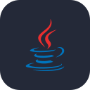

<h1 align="center">Hola 👋, soy Evelyn Larraga</h1>
<h3 align="center">Estudiante de Ingeniería de Software en la Universidad Técnica de Ambato, Ecuador</h3>

  

  

  
  
  

  

## 🖐️ Sobre mí

- Mi nombre completo es **Evelyn Larraga**
- Estudio **Ingeniería de Software** en la Facultad de Ingeniería en Sistemas, Electrónica e Industrial (FISEI) de la UTA
- Me estoy formando como **desarrolladora Full Stack** con React, Node.js, Java y Python
- También me interesan las **redes y la ciberseguridad**, con certificaciones de Cisco y HackerMentor
- Me gusta aplicar metodologías ágiles y trabajar con Git Flow en proyectos de equipo
- 📍 Ambato, Ecuador

## 💻 Proyectos

### 🚀 Proyectos personales

|  | Proyecto | Descripción | Enlace |
| :---: | --- | --- | --- |
|  | **Ajolote Tycoon** | Juego clicker de ajolotes en React y Tailwind con guardado automático, logros, tienda de mejoras y tragamonedas. Publicado con GitHub Actions. | [🎮 Jugar](https://paniwis.github.io/ajoloteTycoon) · [Código](https://github.com/paniwis/ajoloteTycoon) |
|  | **OficiosYA** | Marketplace web y móvil para encontrar y ofrecer servicios locales, desarrollado en equipo. | [Código](https://github.com/paniwis) <!-- reemplaza con el enlace del repo --> |
|  | **Karaoke Web** | Aplicación web de karaoke con letras sincronizadas y sistema de puntuación. | [Código](https://github.com/paniwis) <!-- reemplaza con el enlace del repo --> |
|  | **Registro de Visitas** | Sistema web para registrar visitas, en proceso de mejora y migración a app móvil. | [Código](https://github.com/Belen99158/registro_visitas_site) |

### 🎓 Proyectos académicos

|  | Proyecto | Descripción | Enlace |
| :---: | --- | --- | --- |
|  | **Sistema de Buses Interprovinciales** | Plataforma de transporte interprovincial desarrollada en equipo con Git Flow. Trabajé el módulo de compra de boletos: reservas, pagos y emisión de boletos. | [Código](https://github.com/paniwis) <!-- reemplaza con el enlace del repo --> |
|  | **Sistema de Homologación** | Proyecto final de Metodologías Ágiles para gestionar la homologación de materias, trabajado con Scrum. | [Código](https://github.com/paniwis) <!-- reemplaza con el enlace del repo --> |
|  | **Sistema de Activos Fijos** | Análisis y arquitectura de un sistema de gestión de activos fijos. | [Código](https://github.com/paniwis) <!-- reemplaza con el enlace del repo --> |

### 📚 Aprendizaje

|  | Tema | Descripción | Enlace |
| :---: | --- | --- | --- |
|  | **Oracle SQL** | Prácticas de consultas, JOIN, funciones de grupo y subconsultas. | [Código](https://github.com/paniwis) <!-- reemplaza con el enlace del repo --> |
|  | **Git y ramas** | Ejercicios de comandos básicos, ramas y control de versiones. | [Código](https://github.com/paniwis) <!-- reemplaza con el enlace del repo --> |

## 📫 Contacto

  
  
  
  
  
  <!-- Descomenta y pon tu enlace cuando tengas LinkedIn
  <a href="https://www.linkedin.com/in/TU-USUARIO">LinkedIn</a>
  -->

## 🛠️ Tecnologías y herramientas

  
  
  
  
  
  
  
  
  
  
  
  
  

## 📊 Estadísticas

  

> 💬 *Siempre abierta a colaborar en proyectos, aprender en equipo y conversar sobre tecnología.*

  

  

  
  

## 🧠 Actividad

  

  
  

