

  

  

  
  
  

  

## 🖐️ Sobre mí

- Mi nombre completo es **Evelyn Larraga**
- Estudio **Ingeniería de Software** en la Facultad de Ingeniería en Sistemas, Electrónica e Industrial (FISEI) de la UTA
- Me estoy formando como **desarrolladora Full Stack** con React, Node.js, Java y Python
- También me interesan las **redes y la ciberseguridad**, con certificaciones de Cisco y HackerMentor
- Me gusta aplicar metodologías ágiles y trabajar con Git Flow en proyectos de equipo
- 📍 Ambato, Ecuador

## 💻 Proyectos

### 🚀 Proyectos personales

  <a href="https://paniwis.github.io/ajoloteTycoon"></a>
  

  
  

  
  

  

### 🎓 Proyectos académicos

  
  

  

## 🏅 Certificaciones

|  | Certificación | Institución | Año |
| :---: | --- | --- | :---: |
|  | **Networking Basics** | Cisco Networking Academy | 2025 |
|  | **Linux Unhatched** | Cisco Networking Academy | 2025 |
|  | **Introduction to Cybersecurity** | Cisco Networking Academy | 2024 |
| 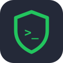 | **Informática Forense** | HackerMentor | 2025 |
|  | **Ethical Hacking: Red Team** | HackerMentor | 2022 |

<a href="https://www.linkedin.com/in/evelyn-larraga-pullas-28147530a/">Ver todas en LinkedIn</a>

## 📫 Contacto

  
  
  
  
  
  

## 🛠️ Tecnologías y herramientas

  
  
  
  
  
  
  
  
  
  
  
  
  

## 📊 Estadísticas

  

> 💬 *Siempre abierta a colaborar en proyectos, aprender en equipo y conversar sobre tecnología.*

  

  

  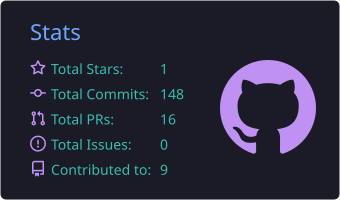
  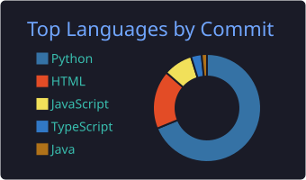

## 🧠 Actividad

  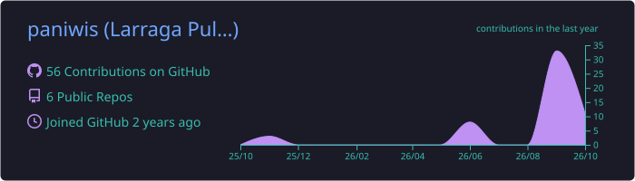

  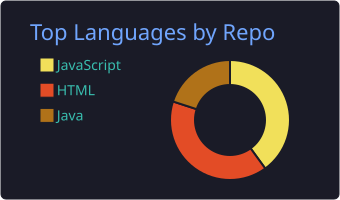
  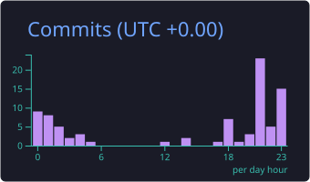

  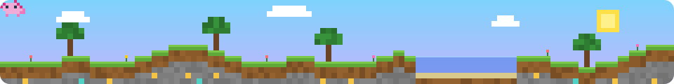

